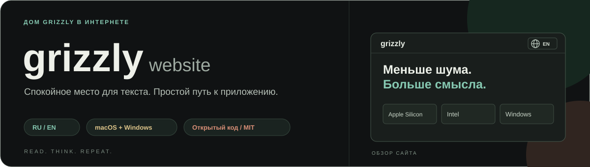
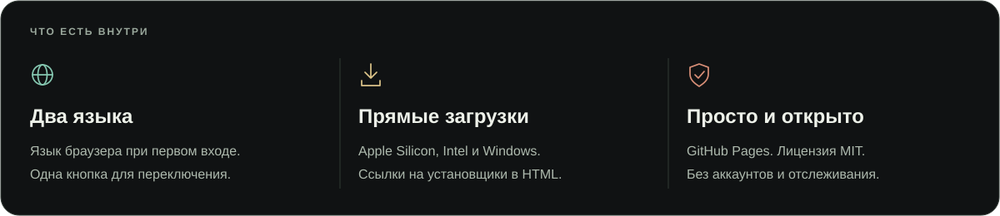
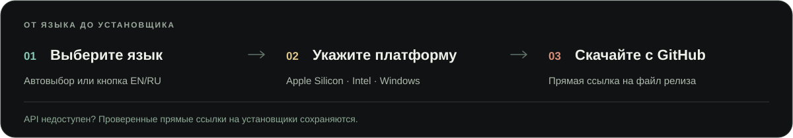

# Grizzly Website

[English](README.md) · **Русский**

[](https://slipcast-dev.github.io/grizzly-website/)

[](https://github.com/Slipcast-dev/grizzly-website/actions/workflows/validate.yml)
[](https://github.com/Slipcast-dev/grizzly-website/actions/workflows/codeql.yml)
[](LICENSE)

Двуязычный сайт-витрина **Grizzly** — приложения для Markdown, текста и исходного кода (подсветка синтаксиса, теги, проверка орфографии, обновление из приложения) на macOS и Windows.

**[Открыть сайт](https://slipcast-dev.github.io/grizzly-website/)** · [Русский](https://slipcast-dev.github.io/grizzly-website/index.html?lang=ru) · [English](https://slipcast-dev.github.io/grizzly-website/en.html?lang=en) · **[Исходники приложения и установщики](https://github.com/Slipcast-dev/Grizzly)**

## Возможности



- Полные русская и английская страницы: переведены демонстрация интерфейса, доступные подписи, метаданные и сообщения о релизах.
- Одна кнопка языка с глобусом и EN/RU в шапке оформлена как контурные кнопки сайта и видна на компьютере и мобильном экране.
- Автоматический выбор на главной странице: русский при предпочтительном языке браузера `ru`, английский при любом другом или отсутствующем значении.
- Ручной выбор имеет приоритет и сохраняется в этом браузере под ключом localStorage `grizzly-language`.
- Главный экран: «Легкое снаружи. Мощное внутри.», название Grizzly с заглавной буквы в шапке и подвале.
- Компактная иллюстрация Python с режимами чтения, исходника и правки. Отступы кода сохранены, лишние переносы между строками убраны; встроенный пример не читает и не редактирует файлы посетителя.
- Блок языков: Python, Swift, C/C++, C#, JavaScript/JSX, TypeScript/TSX, CSS/SCSS и PHP. Блок кода описывает подсветку, редактирование и просмотр двух файлов одновременно.
- Одинаковые кнопки «Скачать Grizzly» и «Что умеет Grizzly» со SVG-значками; подпись о платформах, цене и аккаунте отцентрирована под ними. Кнопка возможностей ведёт в соответствующий раздел.
- Читаемый вспомогательный текст: описания возможностей 14 px, мелкие подписи 11–12 px, усиленный контраст, выровненная навигация с пропорциональным логотипом GitHub и адаптивный подвал.
- Тёмная адаптивная вёрстка без горизонтального переполнения, включая режим уменьшенного движения. Значки скачивания и внешних ссылок выполнены в SVG и не зависят от символов шрифта; кнопки подсвечиваются при наведении.
- Прямые ссылки встроены в обе HTML-страницы и работают сразу, без ожидания JavaScript или GitHub API.
- Публичный GitHub Releases API обновляет ссылки; при его ошибке остаются проверенные прямые ссылки.
- Без сборщика, сторонних JavaScript-зависимостей, аккаунтов, аналитики и cookies сайта.

## Как скачать Grizzly

[](https://slipcast-dev.github.io/grizzly-website/index.html?lang=ru#download)

## Как выбирается язык

`language.js` подключён в head до стилей и отображения содержимого. Порядок выбора:

1. Корректный параметр `?lang=ru` или `?lang=en`; выбор также сохраняется.
2. Сохранённый ранее ручной выбор.
3. Прямая ссылка `en.html` открывает английский, если ручной выбор ещё не сохранён.
4. На главной странице используется предпочтительный язык браузера: `ru` → русский, остальные → английский.

Сайт видит настройки языка браузера, а не отдельную настройку языка ОС; обычно они совпадают. Если localStorage заблокирован, переключение работает при текущем переходе, но выбор не запоминается. Автоматический переход сохраняет параметры URL и якорь раздела. Без JavaScript обе полные страницы, переключатель и загрузки работают, но автовыбор и сохранение выбора недоступны.

Для возврата к автоматическому выбору очистите данные этого сайта в браузере. Кнопка языка всегда перекрывает сохранённое предпочтение: EN открывает английскую страницу, RU — русскую. Скачивание доступно в главном блоке и в карточках платформ.

## Разработка и проверки

Достаточно Python 3.12+ и Node.js 22+. Установка зависимостей и API-ключи не нужны.

```bash
python3 -m http.server 8765 --bind 127.0.0.1
```

Откройте `http://127.0.0.1:8765/`.

```bash
node --check app.js
node --check language.js
node --test tests/*.test.cjs
python3 scripts/validate.py
python3 scripts/package.py
```

Тесты проверяют режимы иллюстрации и их доступность, языки браузера, ручной и сохранённый выбор, отказ хранилища, якоря при перенаправлении, обе языковые страницы, переведённые сообщения о релизах, ошибки API и подмену URL загрузки. Валидатор проверяет обе страницы, единственную кнопку языка и язык её целевой страницы, одинаковые якоря разделов, локальные ссылки, ссылки документации, CSP и закрепление Actions.

Перед слиянием изменений вёрстки проверяйте обе локализации на ширинах 320, 390, 700, 768, 1000, 1280, 1440 и 1920 px, включая режим уменьшенного движения. Проверьте читаемость вспомогательного текста (описания возможностей 14 px, подписи 11–12 px), одинаковые главные кнопки и подпись по центру, выровненную навигацию, логотип GitHub не выше текста и пропорциональные значки ссылок в подвале. На телефоне вводные строки должны оставаться разделёнными, подвал — располагаться по центру; все три режима демонстрации должны работать без горизонтального переполнения страницы. Просматривайте скриншоты в исходном масштабе: Node-тесты и HTML-валидатор не проверяют визуальную вёрстку.

## Структура репозитория

- `index.html` — полная русская страница.
- `en.html` — полная английская страница.
- `language.js` — автовыбор языка и сохранение предпочтения.
- `app.js` — переключение режимов иллюстрации и локализованная проверка релизов.
- `styles.css` — общие стили и переключатель языка.
- `scripts/`, `tests/` — проверки, упаковка и регрессионные тесты.
- `docs/banners/` — SVG-баннеры репозитория на русском и английском. Обновляйте обе версии синхронно; в артефакт сайта эти файлы не входят.
- `README.ru.md`, `SECURITY.ru.md`, `CONTRIBUTING.ru.md`, `CODE_OF_CONDUCT.ru.md` — полная русская документация; файлы без суффикса написаны по-английски.

## Публикация и сопровождение

GitHub Actions публикует сайт после изменения `main`; код PR не может публиковаться. Окружение `github-pages` разрешает только `main`. Артефакт содержит ровно восемь разрешённых ресурсов: `index.html`, `en.html`, `styles.css`, `app.js`, `language.js`, `assets/icon.png`, `.nojekyll` и `.well-known/security.txt`. Документация, тесты и конфигурация репозитория в публикацию не попадают.

Изменения проходят через PR с обязательными Site checks и JavaScript security, актуальностью ветки и разрешёнными обсуждениями. Force push и удаление `main` запрещены, включая администратора. Для одного владельца обязательное независимое одобрение не включено; включите его при появлении команды.

Actions закреплены полными SHA и получают минимальные права; checkout не сохраняет credentials. Dependabot проверяет Actions еженедельно, CodeQL анализирует JavaScript при изменениях и еженедельно.

После релиза приложения обновляйте резервные ссылки в **обеих** HTML-страницах. Сейчас они указывают на проверенные файлы **v1.3.0**. JavaScript может получить более новый релиз, но не меняет статический резервный HTML. Синхронно обновляйте тексты RU/EN, метаданные и обе версии документации. Перед заменой URL проверяйте имена файлов релиза; не подставляйте предполагаемые ссылки вместо рабочих.

После слияния проверьте обязательные проверки и workflow Deploy Pages для слитого коммита, затем сравните публичные RU/EN-страницы и стили с этим коммитом. Публикация облачной среды разработки и публикация сайта — разные действия. Удаляйте завершённые ветки только после проверки, что их изменения сохранены в `main`; после squash-слияния нужно сравнивать содержимое, а не только историю. Ветки с открытыми PR и уникальными изменениями сохраняйте.

## Приватность и ограничения хостинга

Локально сохраняется только ручной выбор языка. Отслеживания посетителей нет. Сайт обращается к `api.github.com` за релизами и скачивает установщики с GitHub; GitHub получает обычные данные HTTP-запроса. Само приложение Grizzly работает офлайн.

Pages принудительно использует HTTPS. CSP и Referrer Policy заданы через HTML. GitHub Pages не предоставляет произвольные HTTP-заголовки; CSP в meta не обеспечивает `frame-ancestors`. Для полного управления заголовками нужен другой хостинг или CDN.

Подробнее: [Безопасность](SECURITY.ru.md), [Участие в разработке](CONTRIBUTING.ru.md), [Кодекс поведения](CODE_OF_CONDUCT.ru.md).

## Лицензия и источники

[MIT](LICENSE) © 2026 Slipcast-dev. Иконка приложения: [Grizzly](https://github.com/Slipcast-dev/Grizzly). SVG-эмблемы Apple/Intel и Windows: [Simple Icons](https://github.com/simple-icons/simple-icons), CC0 (Windows — из версии 11.0.0). Товарные знаки принадлежат их владельцам; эмблемы обозначают поддерживаемые системы.
