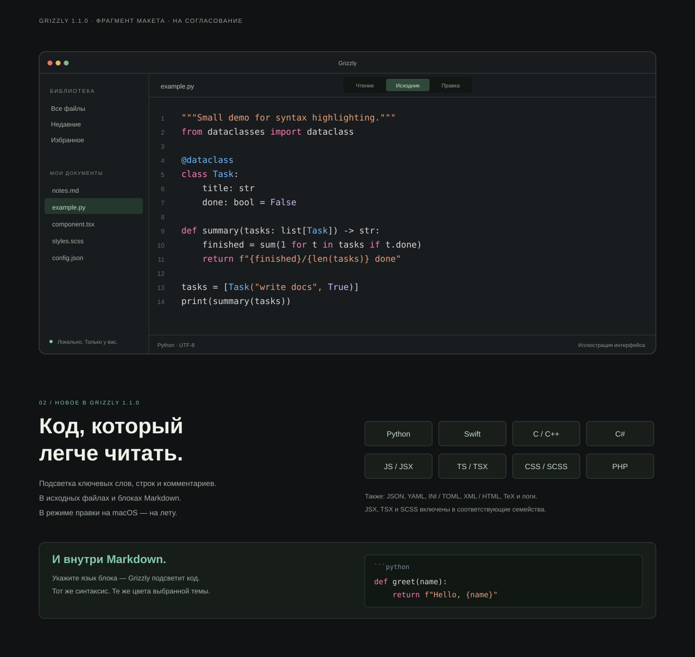

# Макет обновления сайта: Grizzly 1.1.0

[English](README.md) · **Русский**

**Статус: визуальная концепция для согласования. Не опубликована.**

## Посмотреть

- [Полная страница RU](site-ru.svg).
- [Full English page](site-en.svg).
- [Крупный фрагмент: демонстрация и блок языков](syntax-detail-ru.svg).

## Что изменено в концепции

1. Главный блок без плашки релиза; текст и кнопка подняты для сохранения композиции.
2. В строке форматов — Python, Swift, C/C++, JavaScript, TypeScript, CSS и PHP наряду с Markdown.
3. Заголовок блока: «Всё нужное. Теперь — в одном месте». Текст рядом: «Текст. Код. Контекст. Всё, с чем вы сейчас работаете». В демонстрации — Python из примера проекта, номера строк и режим «Исходник». Это иллюстрация, а не скриншот запущенного приложения.
4. Новый компактный блок показывает восемь семейств: Python, Swift, C/C++, C#, JavaScript/JSX, TypeScript/TSX, CSS/SCSS и PHP.
5. Отдельный пример показывает подсветку fenced-блоков Markdown. Подпись о соответствии цветов теме под демонстрацией удалена.
6. Карточка чтения описывает Markdown, текст и блоки кода. Блок загрузок показывает актуальную версию 1.1.0.

Фокус обновления — только подсветка синтаксиса. Сохранены общий порядок страницы, тёмный фон, бирюзовый/золотистый/коралловый акценты, кнопка языка, логотип, исходная PNG-иконка и SVG-эмблемы Apple, Intel и Windows. Палитра кода иллюстрирует существующую тему приложения и не меняет фирменные цвета сайта.

## Проверенные основания

Исследована версия исходников `52778e0d5bf9e473e61f35c2ea1e0a9d8ff6b905`, релиз [v1.1.0](https://github.com/Slipcast-dev/Grizzly/releases/tag/v1.1.0).

| Факт в макете | Источник |
| --- | --- |
| Семейства языков, JSX/TSX/SCSS и расширения | [FileType.swift](https://github.com/Slipcast-dev/Grizzly/blob/52778e0d5bf9e473e61f35c2ea1e0a9d8ff6b905/Sources/Grizzly/Core/FileType.swift) |
| Подсветка ключевых слов, строк, комментариев и многострочных конструкций | [SyntaxEngine.swift](https://github.com/Slipcast-dev/Grizzly/blob/52778e0d5bf9e473e61f35c2ea1e0a9d8ff6b905/Sources/Grizzly/Core/SyntaxEngine.swift) |
| Подсветка fenced-блоков Markdown | [MarkdownView.swift](https://github.com/Slipcast-dev/Grizzly/blob/52778e0d5bf9e473e61f35c2ea1e0a9d8ff6b905/Sources/Grizzly/Render/MarkdownView.swift) |
| Подсветка во время редактирования на macOS | [EditorView.swift](https://github.com/Slipcast-dev/Grizzly/blob/52778e0d5bf9e473e61f35c2ea1e0a9d8ff6b905/Sources/Grizzly/Features/EditorView.swift) |
| Цвета темы Xcode | [Theme.swift](https://github.com/Slipcast-dev/Grizzly/blob/52778e0d5bf9e473e61f35c2ea1e0a9d8ff6b905/Sources/Grizzly/App/Theme.swift) |
| Подсветка в Windows-порте | [core.js](https://github.com/Slipcast-dev/Grizzly/blob/52778e0d5bf9e473e61f35c2ea1e0a9d8ff6b905/electron/renderer/core.js) |
| Формулировка о режимах и ограничение live-подсветки на macOS | [Руководство](https://github.com/Slipcast-dev/Grizzly/blob/52778e0d5bf9e473e61f35c2ea1e0a9d8ff6b905/docs/ru/usage.md) |

Формулировка «на лету» относится к правке на macOS; для Windows такое обещание в макете не используется.

## Пределы этого изменения

В ветке добавлены только SVG-макеты и эта записка. Корневые страницы, рабочие скрипты, стили, README и публикация сайта не изменены. SVG содержат исходную иконку внутри файла, поэтому не требуют внешней загрузки изображения; кликабельной реализации контролов в макете нет.

Следующий этап — только после указаний пользователя: правки концепции или реализация согласованного макета на сайте. Этот PR не следует сливать или публиковать автоматически.
